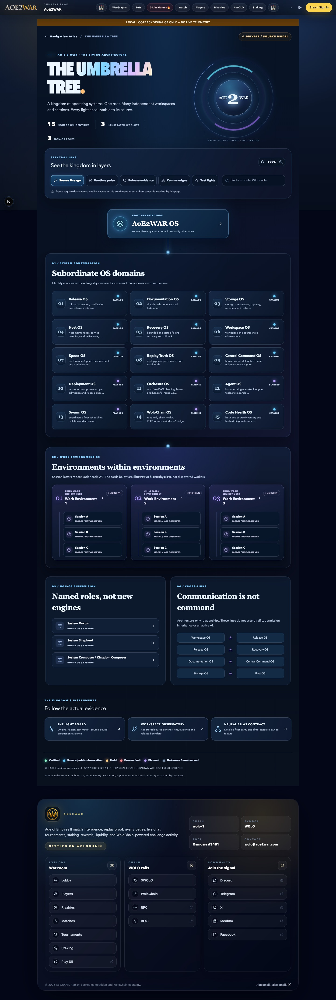
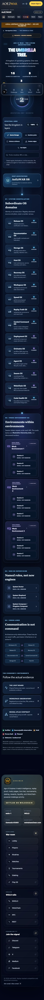

# The Umbrella Tree — visual and evidence design contract

Source-only WE3 feature for [Umbrella Tree #1372](https://github.com/Emaren/app-prodn/issues/1372). Navigation: **private** \`/admin/aoe2war-os/umbrella-tree\` after this feature is separately reviewed, merged and deployed through WE2's existing PRODUCT Integration Gate. Do not fold it into held #1370.

## Hierarchy and source meaning

The sole OS identity catalog is \`config/aoe2war-os-registry.v1.json\` (schema \`aoe2war.os.census.v1\`). The screen projects one AoE2WAR umbrella, 15 registered subordinate OS identities, three non-OS supervisory roles, and scoped Work Environment OS child slots. Nested session identities are pairs \`(workspaceId, sessionLetter)\`, so **WE1/Session A and WE2/Session A differ**. The WE1/WE2/WE3 session cards intentionally illustrate legal structure and do **not** assert detected ChatGPT conversations, real agents, or ownership/permission. Every runtime slot remains UNKNOWN without separately admitted observation. Historical aliases do not create extra OSes. Green status never bubbles up from a child.

## Visual grammar and contrast

Original visual treatment: obsidian floor, beveled sapphire glass, brushed-metal typography, spectral violet/cyan/gold light scattering and a clearly labelled **decorative** orbit. No copied movie artwork or GPU particle engine. Restraint over flashing. Layout is a semantic HTML tree presentation, not an arbitrary visually believable network simulator.

| Signal | UI tint | Admissible meaning |
| --- | --- | --- |
| VERIFIED | Jade | Only independent accepted proof explicitly scoped to this node; not shown by source taxonomy |
| OBSERVED | Cyan | Dated registry **source** when source lens selected; for release only, fresh public Factory source observation |
| HOLD | Amber | Independently evidenced blocker; never inferred from absence |
| FAULT | Red | Independently evidenced actual failure; never inferred from missing receipt |
| CANDIDATE | Violet | Draft/proposed identity from the canonical source catalog; NOT active |
| UNKNOWN | Neutral slate | Missing, stale, malformed, untrusted or inapplicable proof |

Color is accompanied by explicit text, shape/position, and detail-page explanation. The glow never conveys a fake agent heartbeat. The slow rotating rings have the written legend **DECORATIVE**, are not tied to work status, and stop under \`prefers-reduced-motion: reduce\`. No source polling loop or background browser service exists.

## Data and authority boundary

The server page inherits existing \`/admin\` layout protection **and calls \`requireServerAdmin()\`** explicitly. It projects static registry data without credentials or native host access. The only client observation is a **single** bounded, abortable GET for existing same-origin \`/factory/status.json\`; \`readFactoryPublicStatus()\` performs the canonical schema/freshness/field checks. A successful public source observation lights Release OS **cyan**, not jade. It does NOT certify a private release seal, signer permit, per-workspace agent, Storage OS health, financial funding or current signed T10. All other runtime lights remain UNKNOWN. Source and runtime overlays are intentionally distinct.

Existing **THE LIGHT BOARD** at \`/factory\`, authenticated Work Environment Observatory \`/admin/central-command/lanes#work-environments\`, and the separate [Neural Atlas #1371](https://github.com/Emaren/app-prodn/issues/1371) remain their own read-side authorities. Architectural handoffs are marked \`CATALOG_ONLY\` and cannot create cross-system permissions.

## Interaction and performance budget

- Native buttons for every OS, WE, role and session slot; keyboard Enter/Space activate; Escape closes modal drawer and restores focus; Tab stays inside the open details dialog.
- Five evidence overlays; filter; zoom 85–115%; per-node drilldown; safe internal/external source links.
- Responsive 375px, 768px, 1440px plus 1920px, no horizontal viewport scroll and minimum touch targets approximately 40px. Reduced-motion still shows all hierarchy and statuses.
- 120 WE × 3 nested illustrative sessions are handled in the pure model with stable IDs in under 500ms on the Mac test environment. The UI progressively limits rendered OS/WE cards, rather than animating hundreds of permanent particle/edge elements.
- No cron, interval, WebSocket, EventSource, root process, extra runtime, GitHub server proxy, SQL, financial API or production publisher. External network requests per page: **at most one bounded same-origin Factory GET**.

## Real Chrome preview witnesses (local simulated source, not production)

The screenshots are genuine headless Chrome renders of the exact UI component, obtained through a **temporary loopback-only preview route**, now removed from the committed source. Orange top banner deliberately warns the preview is not a live authenticated release. The original app's site-wide header/footer remain visible; this feature adds no second runtime or public-facing route. Browser QA also covered a 768px tablet viewport and 120 illustrated WEs, Escape/focus, reduced-motion and accessible dialog landmarks. Never cite these screenshots as HEL1 deployment or signed Factory evidence.

## QA and source-integrity checklist

\`node --experimental-strip-types --test tests/umbrella-tree-contract.test.mts\` checks registry count, scoped identity, 120-WE scale, invalid/malicious evidence, no fake live status, admin guard, performance semantics and reduced-motion. Complete Prisma, TypeScript, Next production build, real Chrome desktop/tablet/mobile screenshots, keyboard/focus and responsive verification are separate exact-source receipts. If browser or signed release evidence is missing, leave the candidate **SOURCE_READY_HELD**.

**Scope:** standalone follow-on WE3 PR from canonical main; WE2 owns integration, documentation admission, signed Factory physical release and T10. No edits to the held #1370 source.
