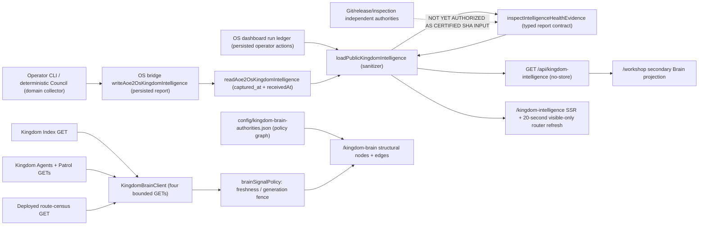

# Kingdom Brain, Progress and Patrol Contract

## Authority, never duplication

- **Kingdom Intelligence** (`docs/KINGDOM_INTELLIGENCE.md`) remains the deterministic operational Brain. It owns state collection and operator recommendations.
- **Kingdom Brain** (`/kingdom-brain`) is an interactive, visual *authority and dependency atlas*. Its versioned structural registry is `config/kingdom-brain-authorities.json`. It never claims a declared ownership edge is a fresh healthy process.
- **Kingdom Progress** (`/kingdom-progress`) is an evidence-first visual campaign register. `config/kingdom-progress-projects.json` lists project scopes and possible milestones, but none is accepted as complete without separate authenticated and exact-source completion evidence.
- **Kingdom Agents** continues to project real General Inspections watchposts and Kingdom Intelligence system signals. `config/kingdom-patrol-disciplines.json` declares eight diagnostic disciplines; `lib/kingdomPatrolCoverage.ts` computes assignment policies for registered Kingdom Index pages. Policy-only rows are not active agent processes, scans or quality certificates.
- **Kingdom Index** retains the existing 30/25/20/15/10 rubric, specialist gates, historical score lineage, and current-evidence rules. This change does not modify that rubric.
- **SpeedOS** retains its separate source-template inventory and dated benchmark representatives. Historical 78 measured URLs, 68 baseline Index public routes and historical 110 total page entry points are different sets, not conflicting measurements of one variable.

## Public read-only contract

- `/kingdom-brain` reads only `/api/kingdom-index`, `/api/kingdom-agents`, and `/api/kingdom-patrol`. It must distinguish policy coverage, source-dated signals, and independently verified operational health.
- `/kingdom-progress` reads existing sanitized `/api/kingdom-intelligence` only to show source observation recency. No project completion percentage, AI hours, commits, deployment status or milestone acceptance is inferred from that source. A future authenticated progress-evidence adapter is separately required.
- Both pages use bounded foreground-only polling and network deadlines, no new background collection workers, no financial mutations, no unrestricted logs and no authority to certify or release anything.
- A future route-wide census must count file templates (public, private utility, sensitive dynamic, admin), distinct benchmark URLs and API handlers separately, all generated from source and versioned build proofs.
- No existing page's visual design is changed by these new pages. The new views are high-density, visual-first instruments; descriptions exist for accessibility and direct authority drilldowns rather than explanatory prose walls.

## Exact deployed Next.js route census

The read-only `/api/kingdom-route-census` instrument reads the bounded, local `.next/server/app-paths-manifest.json` of the **running deployed build**. It counts unique page templates separately from API handler files. It classifies public static, public dynamic, public utility, authenticated admin and sensitive dynamic invoice surfaces without exposing operator route paths or individual sensitive IDs.

This is a *build output* observation, not a source-branch estimate or a fresh browser speed benchmark. Source-linked Kingdom Index registered-route counts remain separately owned by the existing 70-route candidate catalog. Speed's 78-route old performance cohort stays historical. The manifest reader does not accept request-controlled paths, follows no final symlink, caps input size and entries and caches a read for two minutes. Missing/malformed manifests result in `unavailable` (HTTP 503); no fallback historical count is presented as live.

Node source / runtime roles: `lib/kingdomBuildRouteClassifier.ts` (pure bounded taxonomy), `lib/kingdomBuildRouteCensus.ts` (server-only bounded reader), `app/api/kingdom-route-census/route.ts` (sanitized no-store projection), `tests/kingdom-build-route-census.test.mts` (synthetic parser regression evidence).

## Before anyone assigns 100/100

Release-build dependency closure, criterion-level independent evidence, current production browser checks and current-source certification are required. A route-local Git blob fingerprint cannot account for every shared import. New routes begin unmeasured until existing auditors prove otherwise.

## Progressive rollout

1. Integrate the source registries, new visual surfaces and pure policy-only patrol coverage under CI on a draft PR.
2. Audit live production/source counts with `./bin/aoe2war speed inventory`, reconcile with the existing protected Index census.
3. Attach real receipts for route-level source checks, deployments, security, browser performance, sensor status, and agent inspections. Avoid duplicate heavy file scans on public GETs.
4. Add a separate evidence-backed project-milestone adapter; only then may progress pills fill automatically.
5. Evaluate future `/kingdom-recovery`, `/kingdom-sensors`, `/kingdom-tests`, `/kingdom-systems`, and Replay Laboratory against existing AoE2WAR OS, General Inspections, VPSSentry, Kingdom Intelligence, and Parser Observatory. New pages require unique evidence authority and useful visual contracts; do not invent thin aliases.
6. Keep the War Satchel/Auto Bets financial worktree and WoloChain HOLD untouched; build/deploy these visual routes through ordinary protected app controller only.

## Operations and incident memory

Telemetry/event logs should become summarized, rate-limited, retained diagnostic **receipts** with explicit data owner, correlation identifier, source SHA, timestamp, severity, remediation and closure evidence. A recurring agent reads bounded new evidence and known unresolved failures, not raw ever-growing unfiltered logs. Secrets, PII, transactions and signing material are never copied into a public-facing dashboard. Alerts and known fixes should remain linked to the original underlying authority and reopen if the same objectively proven regression returns.


## 2026-10-25 — Tab B authority and P0/P1 trust-boundary review (draft source, not deployed)

### Actual source / consumer flow



**Source-of-truth classification.** Git commit IDs prove committed source, not the active process. A certified production SHA and BUILD_ID require independent runtime/controller receipts; bridge `source.exact` and `source.certification.status` are assertions by the same report, not independent certification. The bridge's `generated_at` is the collection time; `receivedAt` is the later storage receipt, never a freshness reset. Public Intelligence and Workshop are projections, not collectors. The route census is a deployed build-manifest observation; the Index is a different rubric/route universe. The static Brain registry is policy; it does not prove live edges, running agents, financial availability or health. The browser makes four bounded read-only GETs, then uses purely local per-generation/cached presentation. It must not launch a heavy scan on refresh.

**P0/P1 failure boundary.** Before this draft, `numberValue(health.p0) ?? 0` and `numberValue(health.p1) ?? 0` in `lib/kingdomIntelligencePublic.ts` silently turned missing, null or malformed counters into zero findings. A recent receive envelope could consequently display an apparently clean finding tally even with absent severity observations. The draft replaces this with a pure, separately tested bounded projection that requires BOTH nonnegative safe-integer counters, valid UTC capture and receipt timestamps, a fresh <=15-minute two-clock window (+30-second skew), a full source-reported production SHA, source-exact report and no contradictory P0/source invariant before rendering either count. Otherwise `p0/p1=null`, doctor score/status and estate become UNKNOWN. A measured zero survives when BOTH counters are present and the report is usable.

**Versioned sanitized observation shape (draft V1).** `lib/kingdomIntelligenceEvidence.ts` emits `sourceGitSha`, optional reported `buildId`, `collectorAuthority`, `producer`, `observedAt`, `receivedAt`, `ttlSeconds`, `status`, `evidenceUri`, `limitations` and `unknownReasons`. `SOURCE_REPORTED` is explicitly NOT VERIFIED; no bridge field is allowed to fabricate an authenticated public receipt URI. Future consumers must obtain the independently certified production SHA and BUILD_ID via a source-owned, bounded and separately authorized adapter before claiming cross-domain certified health. A source mismatch is CONTRADICTORY, not an invitation to reconcile by recasting data. No independent attestation has been added by this draft.

### Outstanding architecture actions / HOLD

- **Workshop downstream trust defect:** `lib/workshopBrain.ts` still contains `p0: data.health?.p0 ?? 0` and `p1: data.health?.p1 ?? 0`, so the Workshop's *secondary* summary can turn this API's new nulls back into zero. It is OUTSIDE Tab B's exclusive write allocation. Request central assignment for a separate null-preserving Workshop consumer patch before claiming estate-wide P0/P1 closure.
- **Independent live source verification:** Central inspection/release owners must provide an authenticated, cached, sanitized `certifiedProductionSha` / BUILD_ID (no new public GET heavy scanner). Never treat the bridge's own source flags as its own independent witness.
- **PR coordination:** Existing #805 owns the Intelligence page-local Recovery hook, UI and browser tests; #808 owns Brain polling/client/brainSignalPolicy; #745/#821 own shared Instruments. They are not superseded. Latest-only generation, visibility/resume, timeout and multi-feed classification were already implemented on current main and reviewed in their separate source/browser lanes. Physical browser and actual deployed exact-SHA qualification still require central integration.
- **Certification:** This draft is candidate source only. Verify adapter unit/integration tests, exact-head CI, next-build browser state, release source and specialized Index gates under the campaign; no production promotion or 100/100 follows from this patch.

**Next design recommendation:** Keep the deterministic engine, bridge, sanitized adapter, graph policy and individual browser selectors separate. Prefer one trusted typed envelope per source plus explicit join rules at the consumer; avoid a giant shared Brain God object or one new scanner per public request.


## 2026-10-25 — Round Two: minimal certified source join and downstream Workshop correction (DRAFT)

**Existing independent inputs (read-only):**
- `lib/generalInspections/serverSnapshot.ts` projects the protected Finish/release receipt into `GeneralInspectionsSnapshot.releaseSha` (full 40-hex) and `buildVersion`. These are *separate* from the Intelligence bridge's self-reported `source.exact`, production SHA and claimed certificate status. General Inspections is the independently sourced release comparator already used by `lib/kingdomAgentsPublic.ts`; its snapshot must still pass the release controller's actual certification/freshness evidence, not be promoted solely because a typed field is present.
- `lib/kingdomIntelligenceEvidence.ts` exposes a sanitized bridge observation with full `sourceGitSha`, optional reported `buildId`, 15-minute TTL, capture/receive times and a `SOURCE_REPORTED|UNKNOWN|STALE|CONTRADICTORY` status. `SOURCE_REPORTED` does not mean independently CERTIFIED.
- `lib/kingdomReleaseEvidence.ts` already reconciles the inspection's 40-hex production SHA against the 12-hex Intelligence summary for Agents. Reuse this arbitration contract, do not launch another inspection scan from a public page.
- `lib/kingdomBuildRouteCensus.ts` reads the running Next app-paths manifest and public `NEXT_PUBLIC_AOE2WAR_BUILD_VERSION`. This `buildVersion` is **not automatically the actual Next BUILD_ID** from `.next/BUILD_ID` or a signed release controller's artifact receipt. Never compare unlike fields or self-attest build equivalence.

**Proposed smallest source-bound join (requires central authority owner approval, NOT implemented here):**
1. The existing *server-side* General Inspections/release control aggregator supplies an independently certified production receipt containing validated full `certifiedSourceSha`, **actual** `nextBuildId`, certified artifact/release ID, independently observed runtime timestamp, TTL and receipt status. Reuse/carry its already-materialized snapshot. No second heavyweight filesystem/Doctor/CI scan per GET; no trusting bridge-provided `certification.status` for this purpose.
2. A pure, typed join compares `certifiedSourceSha === intelligence.health.observation.sourceGitSha` using **all 40 hex characters**; validates actual `nextBuildId` against independently observed/receipt-backed running Next BUILD_ID (not just `buildVersion`) and the source's observation time/TTL; rejects missing, future, stale or contradictory evidence as `UNKNOWN`, `STALE` or `SOURCE_MISMATCH`. Never turn an absent certificate into a success. The bridge observation cannot independently validate its own production process.
3. Consumers (`Kingdom Agents`, `Workshop Brain`, and any cross-domain KI health merge) may use `VERIFIED` only when the independent source/build/runtime join passes and **all component observations themselves are usable**. Keep basic source-reported telemetry viewable with explicit `SOURCE_REPORTED` labeling; hide certified health assertions, P0/P1 *clearance*, green agent processes and release badges on mismatches. Existing Index criterion/gates remain with their own scorer owner.
4. The resulting public projection exposes only sanitized receipt reference (if explicitly approved), source ID, build ID, status and limitations—not private Finish paths, signer material, sensitive CLI output or release journal internals. No GET mutation and no financial release/chain action.

**Workshop-only implementation now reviewed separately:** `lib/workshopBrain.ts` and the existing Workshop panel preserve `p0/p1=null` when unavailable, stale, structurally invalid or contradictory, and show `UNKNOWN` rather than literal `null` or numerical zero. A valid *source-reported* measured zero remains zero. Workshop no longer treats the bridge self-asserted `source.exact`, `CERTIFIED` or positive global health as independently proved release success. The three Workshop views share this one SSR projection. This makes the consumer fail closed, but does **not** independently certify production.

**Ownership / continued HOLD:** An authorized central integration owner must implement the shared source/build receipt read-side interface, integrate it with Agents and public health claims (without changing `lib/generalInspections/**` or `lib/kingdomIndex*` in Tab B), regenerate DocsV2 intentionally on exact reviewed integration ancestry, re-run source-bound CI and real Chromium on the final combined candidate, then separately qualify live runtime. These are not implied by a successful standalone Workshop PR.


## 2026-10-25 — Renaissance Round Three: one bounded operational evidence/incident interface (DRAFT)

**New source-owned pure contract:** `lib/kingdomOperationalDiagnostics.ts`. It is a *selector*, not a collector, database, health scorer, signatory, alert daemon or a new Brain. The existing `lib/kingdomIntelligenceEvidence.ts` remains the bridge observation parser. The new selector consumes the **sanitized** observation and emits at most eight typed `KingdomOperationalIncident` entries with source reason code, status (UNKNOWN/STALE/CONTRADICTORY/UNAVAILABLE/SOURCE_MISMATCH/BUILD_MISMATCH), owning dependency (`intelligence` or `release`, per `config/kingdom-brain-authorities.json`), affected routes, producing authority, SHA, optional actual-build claim, collection timestamp, evidence age, TTL, sanitized receipt URI (always `null` until separate authenticated public URI contract), precise failure explanation and an *informational* safe read-only next action. No browser-controlled command execution, network I/O, new filesystem scan, release mutation or financial action.

**Pure source/build comparator:** `compareReportedToCertifiedRuntime(bridgeReport, externallySuppliedCertifiedRuntimeClaim, now)` requires valid **full** 40-hex production SHAs, actual (not `NEXT_PUBLIC_AOE2WAR_BUILD_VERSION`) Next BUILD_IDs, valid bounded timestamps and TTLs. It refuses absent/HELD certificates, malformed build IDs, future/expired samples and SHA/build disagreement. Even agreement returns `MATCH_REPORTED`, **never VERIFIED**, because equal user-supplied fields are not independently authenticated proof. Input `certified` must eventually come from a verified, bounded *existing protected release-controller active-runtime receipt*, not from the bridge or a public GET argument. That source and the independent artifact/runtime BUILD_ID proof remain a Central-owned integration requirement.

**Operational data and route-flow:**

```mermaid
flowchart LR
  CLI[Council / OS deterministic collector] --> BR[aoe2Os persisted bridge envelope]
  BR --> I[kingdomIntelligenceEvidence pure sanitizer + TTL]
  I --> D[kingdomOperationalDiagnostics source-owned incidents]
  D --> API[/api/kingdom-intelligence public projection]
  I --> API
  API --> W[Workshop three view modes via workshopBrain]
  API --> KI[Kingdom Intelligence SSR read-side]
  Release[Protected release controller / real BUILD_ID] -. "not yet wired: independent receipt" .-> Join[Pure source/build comparator]
  I --> Join
  Join -. "source comparison only, never attestation" .-> D
  Index[Kingdom Index scorer and certification] -. "separate / read only" .-> B[Kingdom Brain dependency atlas]
  Inspections[General Inspections snapshots] -. "existing Agents join; no duplicate GET scan" .-> B
  API -. "read-only status observations" .-> B
  Graph[Authority registry nodes and edges / policy only] --> B
```

**Fail-closed changes in this draft:**
- The public Intelligence adapter keeps `health.p0/p1=null` when source evidence is missing/stale/future/contradictory. True recorded 0 remains **0** and P1>0 against a P1-zero PASS invariant is now a contradiction.
- `source.reportedExact` and `source.reportedCertificationStatus` retain bridge claims explicitly as *reports*, while `source.exact=false` and `source.certificationStatus=UNVERIFIED` until an independently authenticated active runtime witness exists. Source-authority and Finish-closure PASS invariants do not self-certify through the bridge.
- Without usable health evidence, the public adapter cannot present a positive operating state, positive agent-running state/progress, current Replay/Speed status or Council directive. A source-reported clean observation can supply measured counters, but is **not** a release certificate.
- `/kingdom-intelligence` labels process/doctor/Finish statistics as reported and refuses an independent Source Authority PASS; Workshop preserves `UNKNOWN` instead of zero for absent incidents, active-agent and invariant counts and displays an incident's owner, age/TTL, explanation and next safe read-only action.
- A receiving-server envelope refresh cannot make an older producer capture healthy. Hidden-tab polling and client race controls remain with existing specialist #805 and #808; this change adds no polling.

**Exact Central-owned integration blockers, kept intact:**
1. **Index route provenance:** This candidate modifies the `/kingdom-intelligence` page, public Intelligence adapter transitive dependencies, `/workshop` panel and `lib/workshopBrain.ts`; the source registry must be recomputed for both routes and any other consumer reached via dependency closure on the **final accepted implementation tree**, not a hardcoded guessed fingerprint. The existing #890 drift of `/workshop` is real. **Tab B does not edit `config/kingdom-index-routes.json` or scoring.**
2. **DocsV2:** Central owns intentional `python3 scripts/docs_v2_check.py --write --refresh-baseline` after accepting the exact combined implementation, reviewing any generated DocsV2 index/registry/catalog diff and committing only the authenticated results. Re-run the guard on the final docs-only head; do not bypass it or claim a docs-only commit is release certification.
3. **Independent active production identity:** Central release/General Inspections owner must expose validated, already collected 40-hex active source, *actual* Next BUILD_ID, timestamp, TTL and authenticated receipt status via a bounded server-side adapter. An arbitrary `GeneralInspectionsSnapshot.releaseSha` and `buildVersion` by themselves are not enough to prove active runtime/build. Bind freshness/receipt authentication and reuse already materialized reads; no additional heavy public GET scan.
4. **Cross-domain join:** Central owner of `lib/kingdomAgentsPublic.ts` must require `intelligence.health.observation.status === "SOURCE_REPORTED"` **and independent runtime identity** before publishing positive system-process/current health status; existing 40-hex vs 12-hex SHA prefix arbitration is valuable but only partial. Brain client #808 may project public incident summaries from the existing Intelligence API *after its writer completes*; its current live index/agents/patrol/census classification is preserved here. No new worker and no authenticated system/financial mutation.
5. **Certification and runtime:** exact-head Node, PostgreSQL, TypeScript/lint, Next and DocsV2 guards, bounded real Chrome (native tab hide/resume vs simulated visibility clearly distinguished), and independent deployed source/BUILD_ID/runtime proof plus specialty Index gates are still required. `MATCH_REPORTED` is not 100/100 and does not authorize deployment.

**Other known legacy projection defaults left for separately reviewed ownership:** Workspace and storage-campaign fields elsewhere in `lib/kingdomIntelligencePublic.ts` still coerce some missing **non-P0/P1** values to zero; they must not be used as cross-domain positive assurance or certified source identity. These are not silently counted as verified in this draft. No giant refactor, scorer rewrite or hidden automatic operations.


## 2026-10-25 — Round Four: exact tracked prebuild mutation and agent-activity authority HOLD

**Forensic incident (original #895@2b38826261f902cb9abdcbc320f8e86c43a9986e):** [Integrated real Next/Chrome workflow 40207396998](https://github.com/Emaren/app-prodn/actions/runs/40207396998) compiled the real Next application in three independent jobs. After `yarn build` succeeded, each job's protected `git status --porcelain --untracked-files=no` found **exactly one tracked changed file**: `lib/pageChangeManifest.generated.ts`. This is the Gray Dot V2 25-page source-version artifact, **not** the Kingdom Index 88-route registry and **not** a source-code mutation by Next. The canonical package prebuild runs `python3 scripts/generate_page_change_manifest.py`, which hashes actual page-specific source bytes with NUL separators and writes the tracked artifact; the old candidate did not commit the two updated editions.

The failing job log printed this precise **original input-SHA** proposal:

| Gray Dot V2 route | Committed edition on #895 original SHA | Canonical generated edition after build | Scope |
| --- | --- | --- | --- |
| `/workshop` | `src-caae1d2b18e78b6dc68f` | `src-94f92bcd64f172889edd` | 11 page-specific files |
| `/kingdom-intelligence` | `src-4527a5ab790e0f1b7701` | `src-1ad1fe3b1cb8dbf9f060` | 9 page-specific files |

The other 23 editions were unchanged on that source SHA. The protected workflow refuses to emit/copy its `.next/BUILD_ID` receipt **after** a tracked mutation; consequently the later `Missing or unsafe emitted BUILD_ID` diagnostic is a *downstream unsealed receipt* and cannot prove that Next failed to generate a build ID. Do not delete the cleanliness assertion, fabricate the build ID or mark browser checks passed.

**Shared file ownership and exact reseal needed:** The aoe2war-web/Central Gray Dot V2 owner must regenerate `lib/pageChangeManifest.generated.ts` with the canonical unmodified script **after final source freeze**, inspect the diff (only relevant source pages; recompute if this Round Four page edit changes an edition), commit that output, then rerun normal prebuild, assert no tracked changes, read nonempty valid emitted `.next/BUILD_ID`, bind receipts to the actual exact-head source SHA and real asset fingerprints, and execute isolated full Next/Chrome acceptance. This Tab does **not** edit that generated artifact, the 88-route Index registry, DocsV2 canonical shared registry or the workflow/producer. Separately Central Index rehashes `/kingdom-intelligence` and `/workshop` and Central DocsV2 owner intentionally refreshes the baseline with source-verified history and complete diff review.

**Agent runtime authority clarification:** `lib/kingdomIntelligencePublic.ts` emits explicit `agentRuntimeAuthority.status=UNVERIFIED`, `verified=false` until a *separate authenticated active controller source SHA plus actual Next BUILD_ID* can be joined through the authorized Central release/inspection reader. A bridge report with `source.exact=true`, `certification.status=CERTIFIED` and P0/P1=0 is still a **source report**: P0/P1 preserve genuine zero, but `systemAgents[].activeProcess`, positive progress and `ACTIVE/RUNNING` must not appear independently runtime-verified. The public read-side masks positive agent process states as UNKNOWN, preserves safe provenance-labeled negative status observations, and Workshop reports process counts as UNKNOWN/null rather than zero in the absence of independently verified active agent state. No new Doctor, hidden poller, privileged API mutation or financial operation.

**Finite unresolved live blockers:** (1) source-frozen generated manifest reseal, (2) 88-route Index hash reseal, (3) controlled DocsV2 refresh, (4) owner-authenticated active release SHA/real build evidence, (5) Central-owned `lib/kingdomAgentsPublic.ts` joined positive-state gating, and (6) actual exact-head real Chrome and deployed-runtime receipts. No internal `CERTIFIED`, `exact` or pure `MATCH_REPORTED` self-assertion clears any of those.
